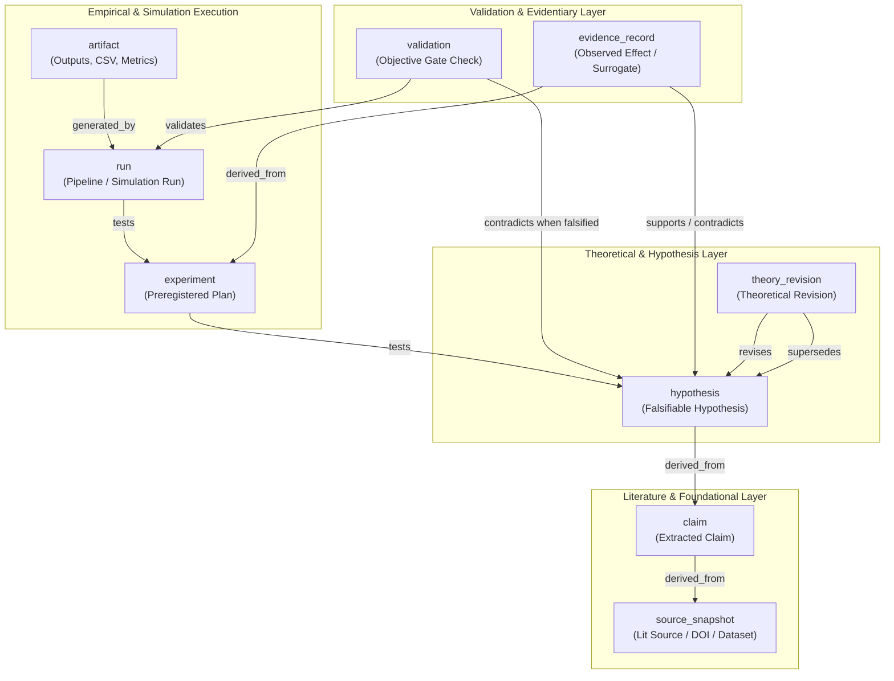

# Awareness Studio Evidence Graph Projection

## 1. Subsystem Overview

The **Evidence Graph Projection** subsystem (`apps.awareness_studio.research_graph`) provides a deterministic, read-only graph projection linking literature, claims, hypotheses, experiments, simulation runs, artifacts, validations, and theory revisions across the NeuroTopology research cycle.

Operating strictly as an epistemic firewall, the evidence graph synthesizes structured artifacts from diverse producers without making database writes, network calls, or solver invocations. It enforces rigorous provenance, duplicate detection, orphan and dangling-reference diagnostics, conflict identification, and explicit scientific safety labeling.



---

## 2. Required Node Types

The subsystem models 9 distinct scientific entities:

| Node Type | Canonical Prefix | Description | Core Attributes |
|---|---|---|---|
| `source_snapshot` | `src:` | Peer-reviewed journal article, preprint, or empirical dataset record. | `source_id`, `title`, `doi`, `evidence_tier`, `source_checksum`, `verification_status` |
| `evidence_record` | `ev:` | Empirical, synthetic, or surrogate observation linking experiments to hypotheses. | `evidence_id`, `evidence_class`, `data_mode`, `observed_metrics`, `is_synthetic` |
| `claim` | `clm:` | Atomic claim extracted from literature with source location and excerpt. | `claim_id`, `claim_text`, `claim_class`, `source_id`, `confidence` |
| `hypothesis` | `hyp:` | Falsifiable proposition with explicit null prediction and criteria. | `hypothesis_id`, `falsification_criterion`, `null_prediction`, `feature_family`, `status` |
| `experiment` | `exp:` | Execution protocol specification and power analysis. | `experiment_id`, `domain`, `design_type`, `power_analysis`, `dataset_ids` |
| `run` | `run:` | Completed simulation or processing execution. | `run_id`, `data_mode`, `elapsed_s`, `verdict`, `metrics`, `artifacts` |
| `artifact` | `art:` | Tangible output file, tensor, report, or summary JSON. | `artifact_id`, `path`, `file_type`, `checksum`, `generator_id` |
| `validation` | `val:` | Formal falsification probe or statistical sanity check report. | `validation_id`, `check_name`, `verdict` (`PASS`/`FAIL`/`AMBIGUOUS`), `metrics` |
| `theory_revision` | `rev:` | Versioned modification of hypothesis or model state. | `revision_id`, `previous_status`, `new_status`, `reason_codes`, `reviewer_id` |

---

## 3. Required Edge Types

Linkages express directed epistemic and causal relationships:

| Edge Type | Source Node -> Target Node | Epistemic Meaning |
|---|---|---|
| `supports` | `evidence_record` / `validation` -> `hypothesis` / `claim` | Empirical observation or passed validation supporting target proposition. |
| `contradicts` | `evidence_record` / `validation` -> `hypothesis` / `claim` | Evidentiary conflict or failed validation falsifying target proposition. |
| `tests` | `experiment` / `run` -> `hypothesis` / `claim` | Operational execution designed to test target hypothesis. |
| `generated_by` | `artifact` -> `run` / `experiment` | Provenance trace showing which execution produced an artifact. |
| `derived_from` | `claim` -> `source` / `hypothesis` -> `claim` | Conceptual lineage and grounding in foundational sources. |
| `validates` | `validation` -> `run` / `artifact` | Quality assurance and data integrity check on execution. |
| `revises` | `theory_revision` -> `hypothesis` | Formal modification of theoretical assumptions or status. |
| `supersedes` | Node -> Previous Version | Version deprecation indicating replacement by newer record. |
| `blocked_by` | `hypothesis` / `experiment` -> Blocker | Operational or methodological barrier preventing execution. |
| `references` | Node -> Node | Informational or contextual citation. |

---

## 4. Evidence Classification & Safety Gating

The projection segregates evidence into 4 non-interchangeable tiers:

1. **`synthetic`**: Output of mathematical simulations, surrogate models, or generative baselines. Tagged with `SYNTHETIC_ONLY`. Can never claim biological proof.
2. **`proxy`**: Heuristic proxy metrics (e.g. proxy Bayes factors, surrogate statistical distances). Tagged with `PROXY_METRIC`. Cannot serve as formal evidence.
3. **`empirical`**: Real-world biological or observational time series without preregistered held-out data lock.
4. **`formal`**: Held-out locked, preregistered empirical executions with signed human review.

### Projection Admission Boundary

The loader is intentionally not an evidence adjudicator. A `source_snapshot` is
classified as `empirical` only when it preserves an upstream
`T1_verified_primary` or `T2_verified_secondary` tier together with
`verification_status: verified`; unverified, disputed, retracted, or
metadata-only sources remain `unknown` or `REVIEW_REQUIRED`.

Likewise, a literal validation `verdict: PASS` is recorded as
`REVIEW_REQUIRED` and does not create a `supports` edge. Provenance, artifact
lineage, labels, nulls, multiplicity, split integrity, and human review must
be independently adjudicated by an upstream gate before a reviewed evidence
record is allowed to support a hypothesis. This prevents self-attested
metadata from becoming scientific support through graph ingestion.

### Safety States
- `PROVISIONAL`: Initial state for proposed hypotheses and unreviewed claims.
- `INCONCLUSIVE`: Assigned when evidence exhibits unresolved tension (`supports` and `contradicts` both present).
- `REVIEW_REQUIRED`: Enforced when conflicting evidence, failed validations, or promotion without human signature occur.
- `SUPERSEDED`: Inactive older version replaced by a newer revision.

---

## 5. Diagnostic Engine

The audit engine runs automatically during graph construction and surfaces diagnostic notices:

- **`orphan_artifact`** (`WARNING`): Artifacts lacking generating runs or validating edges.
- **`dangling_edge_target` / `dangling_edge_source`** (`ERROR`): Edges referencing non-existent nodes.
- **`duplicate_node_content_mismatch`** (`ERROR`): Two entities sharing the same ID with conflicting content.
- **`conflicting_status`** (`WARNING`/`ERROR`): Opposing `supports` and `contradicts` edges on the same hypothesis, or a `FAIL` validation connected via `supports`.
- **`unsupported_promotion`** (`ERROR`): Any hypothesis claiming `supported` or `fact` without a signed human review gate.
- **`synthetic_formal_violation`** (`ERROR`): Synthetic data claiming formal empirical evidence class.

---

## 6. CLI Usage

The projection builder CLI provides end-to-end extraction and export:

```bash
# Build projection from a manifest and produce JSON, Markdown, and Awareness Studio summary
python scripts/build_awareness_evidence_graph.py \
    --manifest inputs/research_cycle_manifest.json \
    --output-json outputs/evidence_graph.json \
    --output-md outputs/evidence_graph.md \
    --output-summary outputs/awareness_summary.json

# Filter projection to only empirical and formal evidence classes with strict error exit
python scripts/build_awareness_evidence_graph.py \
    --manifest inputs/research_cycle_manifest.json \
    --filter-evidence-class empirical formal \
    --strict
```

---

## 7. Scientific Guardrails & Boundaries

1. **No Clinical Claims**: The evidence graph projection models topological and dynamical simulations and literature claims. It makes no medical, therapeutic, or diagnostic claims.
2. **No Ontology Promotion**: Graph nodes represent computational representations, not metaphysical truth or physical ontologies.
3. **No Proof Framing**: Mathematical and empirical findings are reported with confidence bounds and falsification thresholds; no theory-of-everything or definitive consciousness solution is asserted.
4. **Offline and Solver-Free**: The subsystem uses Python standard library only; no torch, scipy, or external solvers are imported.
