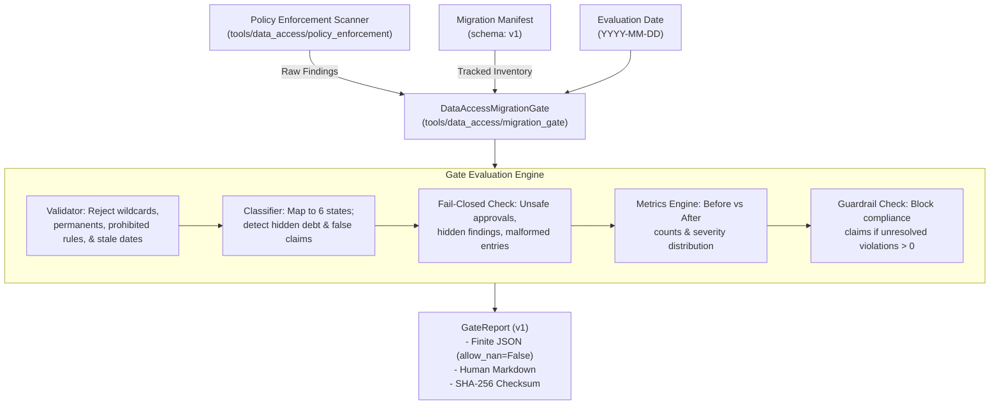

# Data-Access Migration Gate

## Executive Summary

The **Data-Access Migration Gate** is an additive verification subsystem in `NeuroTopology-Sim` designed to track, audit, and safely govern legacy remote data-access violations without hiding or silently suppressing them.

Rather than bypassing static policy enforcement or granting blanket exemptions, the migration gate consumes scanner findings as input, cross-references them against an authoritative versioned **Migration Manifest**, and classifies each finding into one of six strictly defined states.

Any untracked finding, stale exception, wildcard expression, permanent exemption, or attempted exception on prohibited safety rules causes the gate to **fail closed**.

> [!IMPORTANT]
> **Zero False Compliance Invariant**:
> Repository-wide data-access compliance is **never** claimed while unresolved findings remain. Even if all violations are properly tracked and time-bounded under temporary exceptions, the gate explicitly marks repository-wide compliance as **PROHIBITED** until 100% of data access is safely migrated to approved, bounded chunk-cache adapters.

---

## Subsystem Architecture



---

## Classification Taxonomy

Every scanner finding and manifest entry is classified into exactly one of six states:

| Classification State | Semantics | Blocker? | Resolved? |
| :--- | :--- | :--- | :--- |
| `unmigrated` | Acknowledged legacy data-access violation with a named owner and migration reference (PR/issue/RFC), scheduled for migration. | No (tracks debt) | No |
| `safely migrated` | Violation resolved by migrating to approved adapters (e.g. `ChunkCacheEngine`, `HTTPTransferAdapter`). Verified by scanner. | No | Yes |
| `reviewed temporary exception` | Validated, time-bounded exception approved by a designated reviewer with explicit justification. Valid until expiration date. | No | No |
| `unsafe blocked` | Prohibited exception attempt, permanent exemption, wildcard pattern, stale exception, hidden violation, or false migration claim. | **Yes** | No |
| `not applicable` | Non-production fixture or hermetic test case verified to not perform external network access, with approved justification. | No | Yes |
| `unable to assess` | Entry or finding that is malformed, missing mandatory metadata, unparseable, or unverifiable. | **Yes** | No |

---

## Required Manifest Metadata

Wildcard expressions and anonymous entries are strictly rejected. Every entry in a migration manifest requires exact metadata:

```json
{
  "file": "scripts/fetch_real_datasets.py",
  "symbol_or_line": "45",
  "rule": "UNAUTHORIZED_DIRECT_HTTP_RETRIEVAL",
  "owner": "@christianv",
  "migration_reference": "PR #235",
  "status": "reviewed temporary exception",
  "severity": "error",
  "reviewer": "security-lead",
  "expires_at": "2026-12-31",
  "justification": "Temporary legacy metadata endpoint awaiting chunk-cache migration.",
  "notes": "Bounded to HTTP HEAD metadata probe."
}
```

### Mandatory Fields

1. **`file`**: Exact relative repository path (e.g., `scripts/fetch_real_datasets.py`). Wildcards (`*`, `?`, `**`, `[ ]`) are rejected.
2. **`symbol_or_line`**: Exact symbol name (e.g., `fetch_object`) or line number. Wildcards (`*`, `any`) are rejected.
3. **`rule`**: Explicit policy scanner rule name.
4. **`owner`**: Named maintainer or team handle responsible for the migration (e.g., `@christianv`, `@antigravity-c`).
5. **`migration_reference`**: Trackable PR, RFC, or issue reference (e.g., `PR #235`, `RFC-008`).
6. **`status`**: One of the six `MigrationStatus` enum values.

### Additional Fields for `reviewed temporary exception`

- **`reviewer`**: Named reviewer who evaluated and granted the exception.
- **`justification`**: Concrete technical rationale explaining why the exception is necessary and what controls mitigate risk.
- **`expires_at`**: Strict ISO date (`YYYY-MM-DD`). Must not be in the past, and cannot be a permanent token (`permanent`, `never`, `infinite`, `unlimited`, `None`).

---

## Prohibited Exception Rules

Exceptions can **never** be approved for the following safety-critical rules and categories. Any entry attempting an exception for these rules is immediately classified as `unsafe blocked` and causes the gate to fail closed:

### Prohibited Rules

- `UNAUTHORIZED_OPENNEURO_DOWNLOAD`: Direct full-dataset OpenNeuro CLI downloads.
- `UNAUTHORIZED_AWS_FULL_TRANSFER`: Direct `aws s3 cp` or `aws s3 sync` invocations.
- `UNAUTHORIZED_SHELL_TRANSFER`: Shell-based downloader tools (`wget`, `curl`).
- `UNAUTHORIZED_BOTO3_FULL_OBJECT`: Unbounded boto3 `download_file` or `download_fileobj`.
- `UNBOUNDED_REMOTE_MATERIALIZATION`: Unbounded remote reads without explicit byte ranges.
- `MISSING_CACHE_BOUND`: Materialization lacking an explicit byte/cache budget.
- `MISSING_CHECKSUM`: Missing source checksum declarations.
- `OUTPUT_ROOT_ESCAPE`: Output paths escaping configured bounds or using parent traversal (`..`).
- `NETWORK_ENABLED_BY_DEFAULT`: Code enabling network or download access by default (`network=True`).
- `POLICY_READ_FAILURE`: File read error preventing scanner inspection.
- `POLICY_PARSE_FAILURE`: Unparseable syntax in production Python files.

### Prohibited Categories

- `full_dataset_download`
- `unbounded_materialization`
- `path_containment`
- `network_policy`
- `scanner_failure`

---

## Fail-Closed Enforcement

The migration gate fails closed (`gate_passed = False`) under any of the following conditions:

1. **Hidden / Untracked Findings**: The scanner discovers a policy violation that is not recorded in the migration manifest.
2. **Stale / Expired Exceptions**: A reviewed temporary exception has passed its `expires_at` date without renewal.
3. **Unsafe Approvals**: An exception was attempted for a prohibited rule, category, wildcard path, or with permanent expiration.
4. **False Migration Claims**: The manifest claims a finding is `safely migrated`, but the scanner still detects an active policy violation at that location.
5. **Missing or Malformed Inputs**: The scanner report or manifest is missing, corrupt, unreadable, or lacks required fields.
6. **Strict Mode Enabled**: When `--strict` is set, the gate fails if *any* unmigrated debt or temporary exceptions remain.

---

## Metrics: Before vs. After Tracking

The gate provides observable metrics separating raw debt from post-classification status:

### Before Counts (Raw Scanner State)
- Total raw scanner findings
- Severity distribution (`critical`, `error`, `warning`)
- Breakdown by rule and category

### After Counts (Post-Classification State)
- `safely_migrated`: Count of successfully migrated items
- `reviewed_temporary_exception`: Count of active, valid temporary exceptions
- `unmigrated`: Count of tracked legacy debt
- `unsafe_blocked`: Count of blocked safety violations
- `not_applicable`: Count of verified non-applicable entries
- `unable_to_assess`: Count of unparseable/malformed entries
- `unresolved_total`: Sum of `unmigrated`, `reviewed_temporary_exception`, `unsafe_blocked`, and `unable_to_assess`
- `resolved_total`: Sum of `safely_migrated` and `not_applicable`

---

## CLI Reference

The CLI entrypoint is located at `scripts/evaluate_data_access_migration.py`.

```bash
# Evaluate precomputed scanner report against migration manifest
python scripts/evaluate_data_access_migration.py \
  --scanner-report reports/data_access_policy_report.json \
  --manifest manifests/data_access_migration_manifest.json \
  --output-json reports/migration_gate_report.json \
  --output-markdown reports/migration_gate_report.md

# Evaluate with strict zero-tolerance mode (fails on any unmigrated debt)
python scripts/evaluate_data_access_migration.py \
  --scanner-report reports/data_access_policy_report.json \
  --manifest manifests/data_access_migration_manifest.json \
  --strict

# On-the-fly targeted path scan and evaluation
python scripts/evaluate_data_access_migration.py \
  --scan-path scripts/fetch_real_datasets.py \
  --scan-path scripts/eeg_topology_ds005620.py \
  --manifest tests/data_access/migration_gate/fixtures/clean_manifest.json
```
