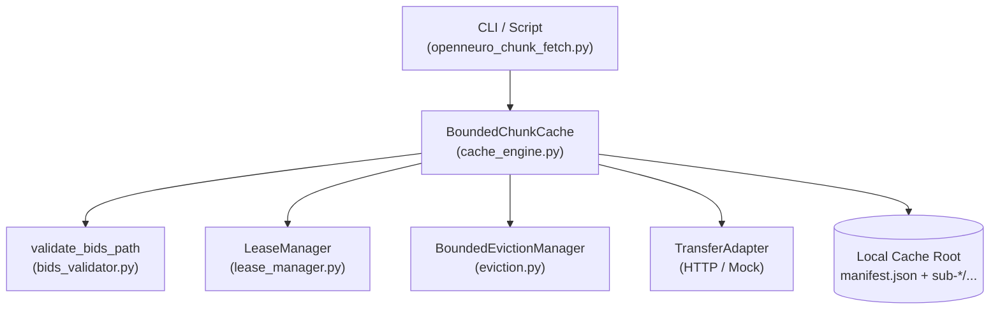

# Manifest-First Bounded Chunk Cache for OpenNeuro/BIDS

## Overview

The `tools.data_access.chunk_cache` package provides a manifest-first, resumable, memory- and disk-bounded chunk-download cache for OpenNeuro and BIDS neuroimaging/electrophysiology datasets.

The system is designed for high-reliability environments where unconstrained full-dataset downloads exhaust available local storage, disrupt active processing pipelines, or violate security containment boundaries.

---

## Core Operational Policies & Scientific Guardrails

1. **Manifest-First Metadata Registration:**
   - Object metadata (expected size, BIDS relative path, source URI, and expected checksum when available) must be registered in the local manifest before data bytes are transferred.
   - Downloading unregistered objects is explicitly forbidden.

2. **Strict Fail-Closed Network Policy:**
   - All network operations are disabled by default.
   - Any transfer attempt when `allow_network=False` fails immediately with `NETWORK_DISABLED`.
   - Explicit opt-in via `--allow-network` or `allow_network=True` is required for live network transfers.

3. **No Full-Dataset Downloads by Default:**
   - The cache operates strictly on single files or byte-range chunks (`ChunkRange`).
   - Bulk or wildcard dataset-level downloads are rejected by design.

4. **Bounded Cache Budget & Pre-Flight Disk Headroom:**
   - Cache occupancy is strictly constrained to `max_cache_bytes`.
   - Before any transfer starts, pre-flight checks verify that available physical disk space minus `min_free_headroom_bytes` (default 50 MB) can comfortably accommodate the incoming chunk. If not, the transfer is rejected with `DISK_EXHAUSTION` before touching the network or disk.

5. **Active Lease Protection Against Eviction:**
   - Active pipelines and concurrent reader processes acquire reference-counted `LeaseHandle` tokens on cached items.
   - Leased items (`lease_count > 0`) are immune to eviction.
   - Leases support time-to-live (TTL) auto-expiration to prevent perpetual deadlocks from abandoned processes.
   - If cache budget is exhausted and remaining items are protected by active leases, downloads fail safely with `ACTIVE_LEASE_LOCKED`.

6. **Bounded LRU Eviction & Metadata Preservation:**
   - When cache pressure necessitates eviction, unleased items (`lease_count == 0`) are evicted in strict Least-Recently-Used (LRU) order.
   - When a chunk is evicted, its physical file is deleted, but its manifest metadata record is preserved with status `EVICTED`, keeping audit history intact.

7. **Path Traversal Prevention & Containment Security:**
   - All BIDS paths are normalized and strictly validated.
   - Parent directory traversal (`..`), absolute paths, Windows drive letters, and invalid characters (`<>:"|?*`) are rejected.
   - The eviction and cleanup managers strictly verify that any unlinked file is contained inside `cache_root` (`is_relative_to(cache_root)`). Any attempt to delete outside raises `EvictionSecurityError`.

8. **Stale Partial Download Cleanup:**
   - In-flight transfers write atomically to `.part.<uuid>` files before being renamed into their final destination.
   - Interrupted or abandoned partial files can be cleaned up via `cleanup_stale_partials()`.

9. **Deterministic, Tamper-Evident Reporting:**
   - Inspection reports (`CacheReport`) include cryptographic SHA-256 digests over canonical JSON representations.
   - Reports reject non-finite float values (`NaN`, `Infinity`) and can be verified via `verify_cache_report_checksum()`.

---

## Error Classification Taxonomy

The system defines distinct error codes (`CacheErrorCode`):

| Error Code | Meaning | Recovery / Policy Action |
| :--- | :--- | :--- |
| `NETWORK_DISABLED` | Attempted transfer with `allow_network=False`. | Explicitly enable `--allow-network` if authorized. |
| `MISSING_OBJECT` | Object not registered in manifest or 404 on remote source. | Register object metadata or check remote source URI. |
| `PERMISSION_DENIED` | HTTP 403 or filesystem permission error. | Verify access rights or S3 credentials. |
| `DISK_EXHAUSTION` | Physical disk free space minus headroom is insufficient. | Free disk space or reduce min headroom requirement. |
| `CACHE_BUDGET_EXCEEDED` | Single requested chunk exceeds total cache capacity. | Increase `max_cache_bytes`. |
| `ACTIVE_LEASE_LOCKED` | Eviction needed but all items are held by active leases. | Wait for active leases to expire or be released. |
| `CHECKSUM_MISMATCH` | SHA-256 of transferred file does not match expected checksum. | Partial file unlinked; never retried indefinitely. |
| `NETWORK_ERROR` | Transient network reset or timeout exhausted retry limit. | Retry with exponential backoff. |
| `INVALID_BIDS_PATH` | Path fails BIDS structure validation or attempts traversal. | Correct BIDS path format. |

---

## Architecture & Components



### Module Breakdown

- `tools/data_access/chunk_cache/types.py`:
  Data contracts (`ManifestRecord`, `CacheBudget`, `LeaseHandle`, `TransferPlan`, `TransferResult`, `CacheReport`).
- `tools/data_access/chunk_cache/bids_validator.py`:
  Path parsing, normalization, BIDS entity validation, and traversal rejection.
- `tools/data_access/chunk_cache/lease_manager.py`:
  Thread-safe lease acquisition, release, reference counting, and TTL expiration.
- `tools/data_access/chunk_cache/eviction.py`:
  LRU eviction of unleased chunks, containment security checks, and partial file cleanup.
- `tools/data_access/chunk_cache/transfer.py`:
  Abstract `TransferAdapter`, `HTTPTransferAdapter` with atomic staging, `MockTransferAdapter` for offline unit testing, and `compute_file_sha256`.
- `tools/data_access/chunk_cache/cache_engine.py`:
  The primary coordinating class `BoundedChunkCache`.
- `scripts/openneuro_chunk_fetch.py`:
  Command-line interface supporting `plan`, `register`, `fetch`, `inspect`, `evict`, and `cleanup`.

---

## CLI Usage Reference

The CLI utility is located at `scripts/openneuro_chunk_fetch.py`.

### 1. Dry-Run Planning (Zero Network Calls)

Evaluate whether a transfer is feasible given budget, disk space, and existing cache state without touching the network:

```bash
python scripts/openneuro_chunk_fetch.py --cache-root ./data/cache \
    plan --dataset-id ds005620 --format markdown
```

### 2. Manifest Registration

Register object metadata before downloading:

```bash
python scripts/openneuro_chunk_fetch.py --cache-root ./data/cache \
    register \
    --dataset-id ds005620 \
    --bids-path sub-01/eeg/sub-01_task-rest_eeg.edf \
    --source-uri https://openneuro.org/ds005620/sub-01/eeg/sub-01_task-rest_eeg.edf \
    --size-bytes 16000000 \
    --checksum 3a7b...
```

### 3. Fetch Chunk or File

Download with explicit network authorization:

```bash
python scripts/openneuro_chunk_fetch.py --cache-root ./data/cache \
    fetch \
    --dataset-id ds005620 \
    --bids-path sub-01/eeg/sub-01_task-rest_eeg.edf \
    --allow-network
```

### 4. Cache Audit Inspection

Generate a tamper-evident audit report with cryptographic SHA-256 verification:

```bash
python scripts/openneuro_chunk_fetch.py --cache-root ./data/cache inspect --format json
```

### 5. Manual Eviction

Evict unleased chunks in LRU order to reclaim space:

```bash
python scripts/openneuro_chunk_fetch.py --cache-root ./data/cache evict --target-mb 100
```

### 6. Cleanup Stale Partials

Scan and remove abandoned `.part.*` staging files:

```bash
python scripts/openneuro_chunk_fetch.py --cache-root ./data/cache cleanup --max-age-seconds 3600
```
