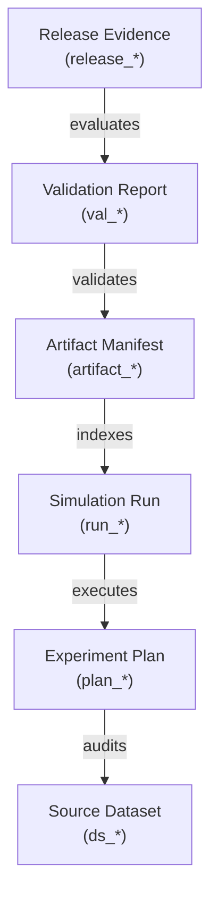

# Research Cycle Evidence Bridge

## Overview

The `tools.research_cycle_bridge` subsystem provides an additive, deterministic, read-only bridge connecting simulation artifacts (`SimulationArtifactLineage.v1`) to the canonical research-cycle ledger (`tools.research_cycle`), evidence graph (`NeuroTopologySim.ResearchCycleEvidenceGraph.v1`), claim gate (`shared.research_claims`), and release-evidence evaluator (`tools.research_cycle_release`).

The bridge operates strictly offline, consumes artifact manifests without executing simulation solvers or importing heavy scientific runtimes, and guarantees parent/child lineage continuity with verifiable SHA-256 digests.

---

## Scientific Guardrails

1. **Never Infer Scientific Validity from Artifact Presence:**
   - The existence of simulation output files (e.g. `summary.json`, `metrics.json`, checkpoints) verifies container integrity and pipeline completion. It does not validate empirical neuroscientific hypotheses.
   - All records default to `scientific_verdict: "NOT_APPLICABLE"` and `scientific_status: "not_evidence"`.

2. **Synthetic and Proxy Non-Promotion:**
   - Synthetic fixtures and benchmark runs are strictly classified as `synthetic_demo_only` / `SYNTHETIC_ONLY`. They are never promoted to empirical evidence.
   - Surrogate or proxy outputs (e.g. information-criterion ratios or beta-1 proxies) are classified as `proxy_only` / `PROXY_ONLY`. They are never promoted to formal Bayes factors.

3. **Preservation of Nulls:**
   - Missing metrics or unobserved quantities remain explicitly `null` (`None`).
   - Zero-filling or fabricating missing values is strictly prohibited.

4. **Strict Rejection of Fabricated or Missing Provenance:**
   - All runs must include authenticated `run_id`, `created_at`, and `source`.
   - Placeholder values (e.g. `"unknown"`, `"null"`, `""`) trigger fail-closed `BLOCKED` or `INCOMPLETE` statuses.

5. **Offline and Local Containment:**
   - Network and cloud URLs (`http:`, `https:`, `s3:`, `gs:`) are strictly rejected.
   - All referenced inputs and runs must reside on the local filesystem.

6. **Finite JSON Serialization:**
   - Reports strictly conform to RFC 8259. `NaN` and `Infinity` tokens are explicitly rejected.

---

## Schemas & Relationships

### Canonical Schemas Consumed (Read-Only)

- **Simulation Artifact Lineage:** `NeuroTopologySim.SimulationArtifactLineage.v1` (`tools.simulation_artifacts`)
- **Research Cycle Plans & Registry:** `ExperimentPlan.v1`, `HypothesisRecord.v1`, `PredictionRecord.v1` (`tools.research_cycle`)
- **Release Evidence Bundle:** `research_cycle_release_bundle.v1` (`tools.research_cycle_release`)
- **Research Claim Records:** `NeuroTopology.ResearchClaim.v1` (`shared.research_claims`)

### Emitted Schema Contracts

- **Bridge Record:** `NeuroTopologySim.ResearchCycleBridge.v1`
- **Evidence Graph:** `NeuroTopologySim.ResearchCycleEvidenceGraph.v1`

### Directed Evidence Graph Relationships



| Source Stage | Target Stage | Relationship | Description |
| :--- | :--- | :---: | :--- |
| `experiment_plan` | `source_dataset` | `audits` | Experiment plan audits requirements of the input dataset. |
| `simulation_run` | `experiment_plan` | `executes` | Simulation run executes the preregistered plan. |
| `artifact_manifest` | `simulation_run` | `indexes` | Manifest catalogs and indexes all outputs generated by the run. |
| `validation_report` | `artifact_manifest` | `validates` | Validation suite audits artifact integrity, finiteness, and completeness. |
| `release_evidence` | `validation_report` | `evaluates` | Release gate evaluates operational review readiness. |

---

## Lifecycle Status & Classification Taxonomy

| Status | Meaning | Evaluator Action |
| :--- | :--- | :--- |
| `COMPLETE` | Run contains all required manifests, summaries, metrics, and validation reports without errors. | Eligible for operational review evaluation. |
| `PARTIAL` | Run was interrupted, resumable, or marked as incomplete. | Marked as `PARTIAL`, never promoted. |
| `FAILED` | Run encountered divergence, explicit error markers, or unhandled exceptions. | Marked as `FAILED`, fails closed. |
| `INCOMPLETE` | Run is missing required artifacts (e.g. `RunRecord.json` or `summary.json`). | Marked as `INCOMPLETE`. |
| `BLOCKED` | Run contains unparseable or non-finite JSON/CSV artifacts. | Marked as `BLOCKED`. |
| `CONFLICTING` | Run manifests declare conflicting run identifiers or duplicate content. | Marked as `CONFLICTING`. |

---

## CLI Usage Reference

The command-line interface is available at `scripts/compile_research_cycle_evidence.py`.

### Basic Compilation (JSON Output)

```bash
python scripts/compile_research_cycle_evidence.py \
    --run-dir ./outputs/simulations/run_001 \
    --cycle-id rc-cycle-001 \
    --output ./outputs/evidence/bridge_run_001.json
```

### Markdown Report Generation

```bash
python scripts/compile_research_cycle_evidence.py \
    --run-dir ./outputs/simulations/run_001 \
    --format markdown \
    --verify
```

### Linking with Preregistered Experiment Plan

```bash
python scripts/compile_research_cycle_evidence.py \
    --run-dir ./outputs/simulations/run_001 \
    --plan ./contracts/research_cycle/plan_001.json \
    --verify
```
