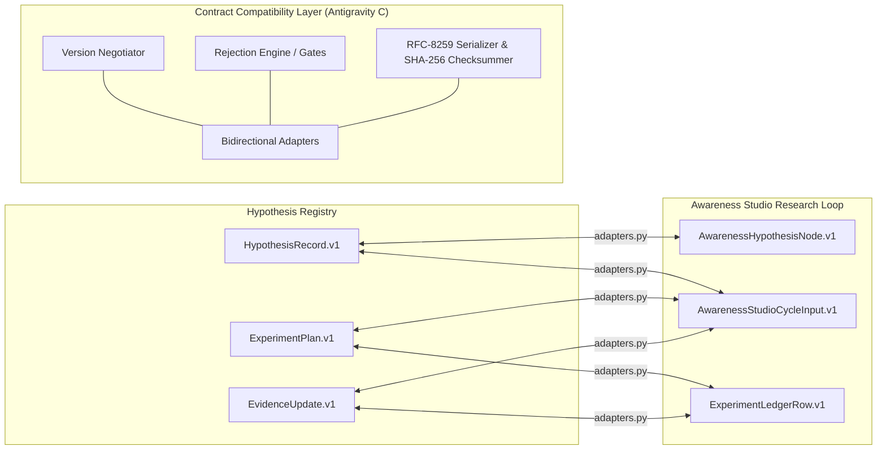

# Research Cycle Contract Compatibility Layer

## Overview

The `tools.research_cycle_contracts` package establishes a robust, bidirectional contract compatibility layer connecting the Hypothesis Registry (`tools.research_cycle`), the Awareness Studio research-cycle orchestrator (`tools.awareness_studio_research_loop`), and external experiment ledgers and evidence stores.

The adapter acts as an epistemic firewall: it ensures that research claims, experiment plans, and empirical outcomes maintain rigorous structural integrity, explicit falsifiability, and tamper-evident provenance without allowing synthetic simulations or unverified proxies to bypass falsification gates.



---

## Retained Contract Fields

The adapter guarantees lossless retention across transformations for the 10 essential fields:

| Field Index | Canonical Field | Source in Registry | Awareness Studio Representation | Ledger Representation |
|---|---|---|---|---|
| 1 | **Hypothesis ID** | `hypothesis_id` | `node_id` | `hypothesis_id` |
| 2 | **Source IDs** | `provenance.source_id` / `source_ids` | `source_ids` | `source_id` |
| 3 | **Dataset IDs** | `dataset_ids` | `dataset_ids` | `dataset_id` |
| 4 | **Falsification Criteria** | `falsification_criterion` | `falsification_criteria` | `falsification_threshold` |
| 5 | **Null Predictions** | `null_prediction` | `null_prediction` | `null_prediction` |
| 6 | **Evidence Class** | `evidence_class` | `evidence_class` | Derived from `data_mode` / `scientific_status` |
| 7 | **Reviewer State** | `human_review_gate` (`passed`, `reviewer`) | `human_reviewer`, `human_review_passed` | `reviewer_signoff` |
| 8 | **Status Transitions** | `status` | `status` | `outcome_status` |
| 9 | **Contradiction Records** | `contradictory_evidence_links` | `contradictions` | `is_contradictory`, `contradiction_reason` |
| 10 | **Integrity Checksums** | `checksum` | `checksum` | `evidence_checksum`, `checksum` |

---

## Non-Negotiable Rejection Rules

The verification engine enforces 7 strict gate policies. Any violation raises `ContractRejectionError` with the corresponding machine-readable reason code:

1. **`missing_source_provenance`**  
   Rejects records lacking a valid `provenance` dictionary, identifiable `source_id`, or valid `source_checksum` / `experiment_checksum`.
2. **`unsupported_promotion`**  
   Rejects any hypothesis claiming status `supported_as_specified` (or ledger row marked `supported`) unless the human review gate is explicitly passed with a verified human reviewer name.
3. **`synthetic_empirical_claims`**  
   Rejects synthetic simulations that claim `empirical_dataset` data types or attempt to directly support biological/empirical hypotheses without surrogate/computational labels.
4. **`missing_falsification_criteria`**  
   Rejects any hypothesis or ledger row missing an explicit, non-empty falsification threshold or criterion.
5. **`missing_null_prediction`**  
   Rejects any hypothesis or ledger row missing an explicit null outcome prediction against which effect sizes can be benchmarked.
6. **`incompatible_feature_families`**  
   Rejects records containing unauthorized feature representations. Permitted feature families:
   - `topological_homology`
   - `triadic_hypergraph`
   - `spectral_coupling`
   - `autonomic_modulation`
   - `dynamical_metastability`
   - `surrogate_null`
7. **`unverified_formal_status`**  
   Rejects empirical claims that omit `dataset_ids`, or evidence relying on heuristic proxies (`proxy_bayes_factor`) that masquerade as formal evidence.

---

## Schema Evolution and Version Negotiation

Contract versioning follows `SchemaName.v{major}[.{minor}]`.

- **Major Version Changes (`v1` vs `v2`)**: Incompatible breaking changes. Version negotiation raises `ContractCompatibilityError`.
- **Minor Version Evolution (`v1.0` to `v1.1`)**: Non-breaking additions. Emits explicit `MigrationWarning` (forward or backward adaptation) while preserving payload integrity.
- **Cross-Schema Adaptation**: Handled explicitly by `adapters.py`, logging `cross_schema_adaptation` warnings while validating semantic equivalents.

Supported schemas:
- `HypothesisRecord.v1`
- `ExperimentPlan.v1`
- `PredictionRecord.v1`
- `EvidenceUpdate.v1`
- `AwarenessHypothesisNode.v1`
- `AwarenessStudioCycleInput.v1`
- `ExperimentLedgerRow.v1`

---

## Deterministic Serialization and Tamper Detection

All contract persistence operations use strict RFC-8259 JSON serialization:
- Sorted dictionary keys (`sort_keys=True`).
- Disallow `NaN`, `+Infinity`, and `-Infinity` (`allow_nan=False`). Non-finite floats are sanitized via `_safe_dict`.
- Canonical SHA-256 digest computation excludes the `checksum` field itself.
- Atomic filesystem writes: files are written to a temporary sibling file before atomic rename (`replace`).

---

## CLI Validator

The package provides a standalone CLI verification and conversion utility:

```bash
# Validate a hypothesis or contract document against non-negotiable gates
python scripts/validate_research_cycle_contracts.py --input path/to/hypothesis.json --check-gates

# Convert a HypothesisRecord into an Awareness Studio node artifact
python scripts/validate_research_cycle_contracts.py --input path/to/hypothesis.json --convert-to awareness_node --output converted_node.json

# Produce structured JSON validation reports for CI pipelines
python scripts/validate_research_cycle_contracts.py --input path/to/contracts/ --json-output
```

Exit codes:
- `0`: Valid and fully compliant with verification gates.
- `1`: Contract rejected or gate violation detected.
- `2`: File not found or argument syntax error.

---

## Guardrails and Epistemic Boundaries

- **No Clinical Claims**: This layer provides technical schema compatibility and data flow validation. It makes no medical, diagnostic, or clinical efficacy claims.
- **No Theory Promotion**: Structural validity does not imply empirical confirmation. Falsification criteria and human review gates ensure all claims remain provisional and testable.
- **No Consciousness or TOE Solved Claims**: The presence of topological homology or hypergraph transition metrics describes mathematical and dynamical properties of simulated or experimental time series, not subjective awareness or unified physical theories.
