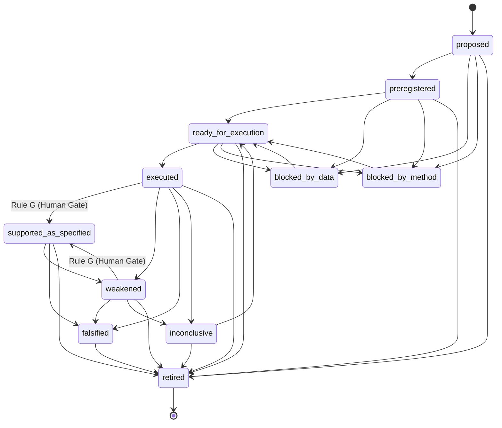

# Research Cycle Registry: Hypothesis and Experiment Loop

## 1. Overview

The Research Cycle Registry (`tools.research_cycle`) provides a typed, versioned, and immutable record-keeping engine for automated scientific hypothesis generation, experiment planning, preregistered predictions, empirical evidence ingestion, and theory revisions.

The registry is explicitly designed around anti-confirmation-bias principles:
- **No Self-Certification**: The system may propose, operationalize, test, and falsify hypotheses, but it must never autonomously certify speculative theory into scientific fact.
- **Permanent Failure Retention**: Disconfirming and contradictory observations never disappear or get overwritten; failed experiments update the hypothesis state to `falsified` or `weakened`.
- **Epistemic Partitioning**: Synthetic simulations, literature claims, and proxy metrics are strictly prohibited from posing as empirical biological proof.

---

## 2. Versioned Record Schemas

All records are immutable, serializable according to RFC-8259, and cryptographically verified via SHA-256 digests.

### 2.1 HypothesisRecord.v1
Each hypothesis contains:
- `hypothesis_id`: Unique identifier (e.g., `hyp_fc_001`).
- `precise_claim`: The unambiguous empirical or computational proposition.
- `construct_definitions`: Theoretical definitions of cognitive or biological constructs.
- `operational_variables`: Measurable independent, dependent, and control variables.
- `predicted_direction`: Expected effect direction (`positive`, `negative`, `bifurcation`).
- `null_prediction`: Expected observable outcome under the null hypothesis.
- `alternative_explanations`: Known confounds or competing hypotheses.
- `falsification_criterion`: Quantifiable threshold separating confirmation from falsification.
- `min_sample_size_or_power`: Statistical power requirements ($N$, $\alpha$, target power).
- `preregistration_reference`: Preregistration registry DOI/identifier.
- `data_requirements`: Explicit datasets or acquisition modalities needed.
- `analysis_plan`: Step-by-step statistical and topological evaluation pipeline.
- `provenance`: Originating agent, timestamp, and context.
- `epistemic_label`: Classification (`speculative_hypothesis`, `preregistered_empirical`, `computational_model`, `surrogate_baseline`).
- `status`: One of the 11 lifecycle statuses.
- `human_review_gate`: Explicit human sign-off record (`passed`, `reviewer`, `timestamp`, `notes`).
- `evidence_links`: Comprehensive list of all ingested evidence update IDs.
- `contradictory_evidence_links`: Explicit list of all contradictory or disconfirming evidence updates.
- `revision_history`: Immutable chronological audit log of all status transitions and modifications.
- `unresolved_questions`: Outstanding methodological or theoretical ambiguities.
- `checksum`: Deterministic SHA-256 digest.

### 2.2 ExperimentPlan.v1
Defines structured, preregistered experiment parameters:
- `plan_id`: Unique experiment plan ID.
- `hypothesis_id`: Associated hypothesis.
- `domain`: Categorization across 6 scientific focus domains.
- `design_type`: Within-subject, crossover, surrogate null, etc.
- `variables`: Concrete independent, dependent, and confounding variables.
- `target_sample_size`: Number of participants or surrogate iterations.
- `power_analysis`: Formal statistical power justification.
- `analysis_protocol`: Algorithmic steps for data preparation and topological extraction.
- `surrogate_method`: Null generation method (`iaaft`, `phase_randomization`, `edge_swap`).
- `data_source`: Dataset access key or repository identifier.
- `is_synthetic`: Flag indicating whether inputs are synthetic simulations.

### 2.3 PredictionRecord.v1
Pre-registered expectations tied to an experiment plan:
- `prediction_id`: Unique prediction ID.
- `hypothesis_id`: Linked hypothesis.
- `plan_id`: Linked experiment plan.
- `metric_name`: Quantifiable topological or signal feature.
- `expected_direction`: Expected outcome direction.
- `expected_effect_range`: Bounded range for the effect size estimate.
- `falsification_threshold`: Quantitative boundary where hypothesis is declared falsified.
- `is_preregistered`: Boolean ensuring prediction preceded empirical observation.

### 2.4 EvidenceUpdate.v1
Observation artifact reporting experimental outcomes:
- `evidence_id`: Unique evidence ID.
- `hypothesis_id`: Evaluated hypothesis.
- `experiment_id`: Execution run identifier.
- `source_checksum`: Cryptographic hash of input dataset/manifest.
- `experiment_checksum`: Cryptographic hash of execution code.
- `data_type`: `empirical_dataset`, `synthetic_simulation`, `literature_claim`, or `proxy_bayes_factor`.
- `is_synthetic`: Boolean flag.
- `is_out_of_sample`: Out-of-sample cross-validation flag.
- `metrics_observed`: Actual quantitative values extracted.
- `observed_effect_size`: Standardized effect size estimate ($d_z$, $r$).
- `observed_p_value`: Inferential p-value.
- `is_contradictory`: Flag indicating whether outcome contradicts prediction.
- `contradiction_details`: Detailed rationale for contradiction.

### 2.5 TheoryRevision.v1
Formal transition log documenting theory evolution:
- `revision_id`: Unique revision ID.
- `hypothesis_id`: Revised hypothesis.
- `previous_status` & `new_status`: Lifecycle delta.
- `reason_codes`: Machine-readable reason identifiers.
- `evidence_ids`: Evidence items triggering the revision.
- `modifications`: Specific updates to theory parameters.
- `unresolved_questions`: Newly raised open scientific questions.
- `human_review_signed`: True if approved by human reviewer.
- `reviewer_id`: Identifier of human reviewer.

---

## 3. Lifecycle States & Allowed Transitions



---

## 4. Promotion & Retention Gates (Rules A through G)

1. **Rule A (Data Requirement)**: A literature claim cannot promote a hypothesis to `executed` or `supported_as_specified` without actual empirical or simulation data.
2. **Rule B (Biological Partitioning)**: A synthetic simulation cannot serve as evidence to promote an empirical biological hypothesis to `supported_as_specified`. Synthetic data can only support hypotheses classified as `computational_model` or `surrogate_baseline`.
3. **Rule C (Bayes Gate)**: A heuristic or proxy Bayes factor cannot serve as formal evidence for hypothesis support. Formal evidence requires empirical cross-validated topological contrast.
4. **Rule D (Out-of-Sample Requirement)**: Computational model improvements must be evaluated on out-of-sample validation data (`is_out_of_sample=True`). In-sample goodness-of-fit cannot support a hypothesis.
5. **Rule E (Failure Retention)**: Failed experiments update the hypothesis state (to `falsified` or `weakened`) and are recorded in `revision_history`. Negative results are never purged or hidden.
6. **Rule F (Contradiction Visibility)**: Contradictory evidence remains permanently indexed under `contradictory_evidence_links` and cannot be overwritten by subsequent positive findings.
7. **Rule G (Human Review Gate)**: Autonomous AI agents cannot self-certify a hypothesis as `supported_as_specified`. Promotion to supported requires explicit sign-off via `human_review_gate.passed=True` with a recorded human reviewer.

---

## 5. Experiment Planning Interfaces

The registry provides six standardized planning builders:

| Planner Class | Domain | Focus Area |
|---|---|---|
| `PairwiseVsTriadicFCPlanner` | `pairwise_vs_triadic_fc` | 2-simplex complexes, O-information, high-order synergy vs bivariate Pearson correlations. |
| `HigherOrderSpectraPlanner` | `higher_order_spectra` | Bispectrum, bicoherence, quadratic phase coupling in multi-scale EEG/fMRI. |
| `RespirationAutonomicPlanner` | `respiration_autonomic_modulation` | Respiratory sinus arrhythmia (RSA), autonomic tone, and visceral-neural topological coupling. |
| `DiscernmentNonjudgmentPlanner` | `discernment_nonjudgment_operationalization` | Analytical discernment vs open monitoring nonjudgment, persistence landscape shifts, metastability. |
| `HypergraphTransitionPlanner` | `hypergraph_transition_forecasting` | Critical slowing down, hypergraph topological variance bursts, state transition forecasting. |
| `NullSurrogatePlanner` | `null_and_surrogate` | IAAFT, phase randomization, topological edge-swapping Monte Carlo surrogates. |

---

## 6. CLI Validation Usage

```bash
# Validate a research cycle registry JSON file
python scripts/validate_research_cycle.py --registry outputs/research_cycle_registry.json

# Emit audit results in JSON format
python scripts/validate_research_cycle.py --registry outputs/research_cycle_registry.json --json-output
```

---

## 7. Scientific Guardrails

- **No Proof Claims**: The registry provides epistemic tracking, not metaphysical truth. Statistical support ($p < 0.05$, $d_z > 0.5$) under a hypothesis model does NOT constitute proof of biological quantum coherence, consciousness, or unified theory.
- **No Clinical Efficacy**: Hypotheses and experiment plans must not formulate medical, therapeutic, or diagnostic claims.
- **Auditability**: All state changes produce an immutable `TheoryRevision.v1` record with cryptographic SHA-256 verification.
