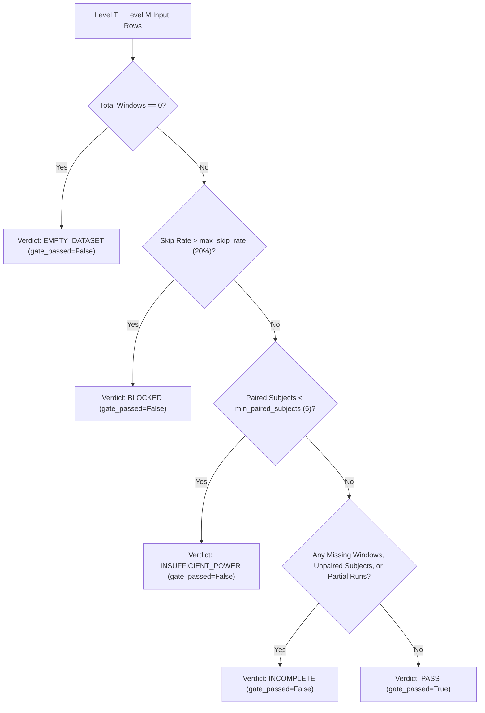

# Level T Topology Missingness Tracking and Cohort Falsification Gates

## Executive Summary

The Level T EEG topology extraction pipeline converts localized channel-voltage time series into topological charge metrics ($q_{\text{net}}$, $q_{\text{abs}}$, $f_{\text{dress}}$, and defect density). In empirical neuroimaging workflows, missing recordings, absent companion sidecars (such as BrainVision `.vmrk` marker files or `.eeg` binary files), corrupted headers, and incomplete cohorts pose an acute scientific threat: **silent zero imputation**.

If a missing window or companion file defaults to numerical zero values ($q_{\text{net}} = 0.0$, $q_{\text{abs}} = 0.0$, $\text{topology\_quality} = 0.0$), downstream hypothesis tests, machine learning decoders, and permutation distributions interpret these zeros as genuine empirical measurements. This manufactures false topological charge cancellation, distorts group comparisons, and generates synthetic evidence out of data acquisition failures.

This document formalizes the fail-closed missingness architecture implemented in `sciencer_d/btc_icft/level_t/base_real_topology.py` and audited via `tests/test_base_real_topology_missingness.py` and `tests/test_cohort_missingness.py`.

---

## 1. Missingness Taxonomy

Every extraction window in Level T carries explicit lifecycle status, validity markers, and granular missingness categorization:

| State Code | Trigger Condition | Telemetry Status | `is_valid` | Metrics ($q_{\text{net}}$, $q_{\text{abs}}$, etc.) |
|:---|:---|:---|:---:|:---:|
| `computed` | Actual signal successfully read and topology computed | `"computed"` | `True` | Genuine `float` values |
| `missing_source_file` | Source recording path does not exist on disk | `"skipped"` | `False` | `None` / `null` |
| `missing_companion_file` | Header exists but required companion file (`.vmrk`, `.eeg`, etc.) is absent | `"skipped"` | `False` | `None` / `null` |
| `failed_read` | Signal reader raised an exception (corrupt data, out-of-bounds window, 0 channels) | `"skipped"` | `False` | `None` / `null` |
| `partial_run` | Subject recording terminated prematurely before window completion | `"skipped"` | `False` | `None` / `null` |
| `unobserved` | Window row instantiated without computed metrics | `"skipped"` | `False` | `None` / `null` |

---

## 2. Distinction: Genuine Zero Observations vs. Missing Data

A central methodological principle of Level T falsification is the unambiguous separation of genuine physical zeroes from missingness:

### Genuine Zero Observation
A valid biological or synthetic EEG epoch may exhibit topological charge balance ($q_{\text{net}} = 0.0$) when positive and negative phase defects cancel out across triangles. This is a true empirical measurement:
- `q_net`: `0.0`
- `q_abs`: $> 0.0$ (or $\ge 0.0$)
- `topology_quality`: $\ge 0.25$
- `is_valid`: `True`
- `topology_status`: `"computed"`
- `replicate_count`: `1`

### Missing Observation
When data acquisition fails or a file is absent:
- `q_net`: `None` (serialized as empty string in CSV, `null` in JSON)
- `q_abs`: `None`
- `topology_quality`: `None`
- `is_valid`: `False`
- `topology_status`: `"skipped"`
- `replicate_count`: `0`
- `warnings`: Detailed diagnostic reason preserved

Under no circumstances is a missing observation assigned `0.0` or treated as neutral evidence.

---

## 3. Statistical Protection Layers

### 3.1 Topology Quality Reporting (`build_topology_quality_report`)
- Evaluates mean quality strictly across valid computed rows ($r.\text{is\_valid} = \text{True} \land r.\text{topology\_quality} \ne \text{None}$).
- Tracks total windows ($n_{\text{total}}$), valid windows ($n_{\text{valid}}$), missing windows ($n_{\text{missing}}$), and window skip rate ($\text{skip\_rate}$).
- Implements four-tier status reporting:
  - `empty_dataset`: $n_{\text{total}} = 0$
  - `blocked_high_skip_rate`: $\text{skip\_rate} > 20\%$
  - `incomplete`: $n_{\text{missing}} > 0$ but $\le 20\%$
  - `pass`: $n_{\text{missing}} = 0$ and all valid rows satisfy quality criteria ($\text{quality} \ge 0.25$, $n_{\text{valid\_triangles}} > 0$)

### 3.2 Artifact Alignment Reporting (`build_artifact_alignment_report`)
- Averages artifact scores and topology quality only over non-null observations.
- Explicitly isolates `missing_topology_rows` and `missing_artifact_scores` without zero-fill substitution.
- Emits warnings when artifact scores are partially unobserved.

### 3.3 Group Significance Permutation Tests (`build_group_significance_report`)
- Filters rows to eligible, valid, warning-free computed observations.
- Enforces `max_skip_rate` gate (default 20%): blocks execution if data loss exceeds threshold.
- Enforces `min_paired_subjects` gate: fails closed if paired subject count is insufficient for statistical power.
- Calculates precision metrics for each condition:
  $$\text{SEM} = \frac{s}{\sqrt{n}}, \quad \text{CI}_{95\%} = \left[\bar{x} - 1.96 \cdot \text{SEM}, \, \bar{x} + 1.96 \cdot \text{SEM}\right]$$

---

## 4. Cohort Audit Gate (`audit_cohort_missingness`)

The cohort audit function validates multi-subject experimental integrity across windows, subjects, conditions, and companion files:

### Gate Decision Rules
1. **`EMPTY_DATASET`**: No Level T rows present for analysis.
2. **`BLOCKED`**: Skip rate exceeds allowable threshold ($> 20\%$). Analysis is halted to prevent drawing conclusions from structurally truncated datasets.
3. **`INSUFFICIENT_POWER`**: Two-condition paired design has fewer than the required minimum paired subjects ($< 5$).
4. **`INCOMPLETE`**: Dataset has valid paired subjects and acceptable skip rate, but contains missing windows, partial subjects, or unpaired conditions. Fails closed (`gate_passed = False`) to prevent premature claim promotion.
5. **`PASS`**: 100% of subjects, companion files, conditions, and extraction windows are complete, valid, and paired.

---

## 5. Output Serialization Conventions

Outputs generated via `write_level_t_topology_outputs` adhere strictly to fail-closed serialization standards:

- **`features_t.csv`**:
  - `None` metric values are written as empty strings (`""`), never `"0.0"` or `"None"`.
  - Metadata columns (`session_id`, `run_id`, `task_label`) remain empty strings when absent.
  - Boolean flags (`is_valid`, `run_status`, `topology_status`) explicitly record window state.
- **`cohort_missingness_report.json`**:
  - Emitted whenever cohort auditing is performed.
  - Contains full subject details, pairing status, missingness reason tallies, and gate verdicts.
  - Strictly finite JSON: no `NaN`, `Infinity`, or `-Infinity` literals.
- **`report.md`**:
  - Automatically incorporates the cohort missingness audit section with safe-claim verification.

---

## 6. Scientific Guardrails & Compliance

In accordance with project operating principles:
- **No Clinical Claims**: Missingness tracking does not diagnose pathology or evaluate clinical outcomes.
- **No Consciousness or Proof Claims**: Topological metrics are operational signal telemetry candidates, not measures of consciousness or ontological proofs.
- **No Real-Data Execution in Test Suites**: All tests use synthetic signals, isolated temporary files, and mocked I/O.
- **Never Convert Missingness Into Evidence**: Unobserved data remains unobserved; absence of data is never interpreted as confirmation of a null or alternative hypothesis.
