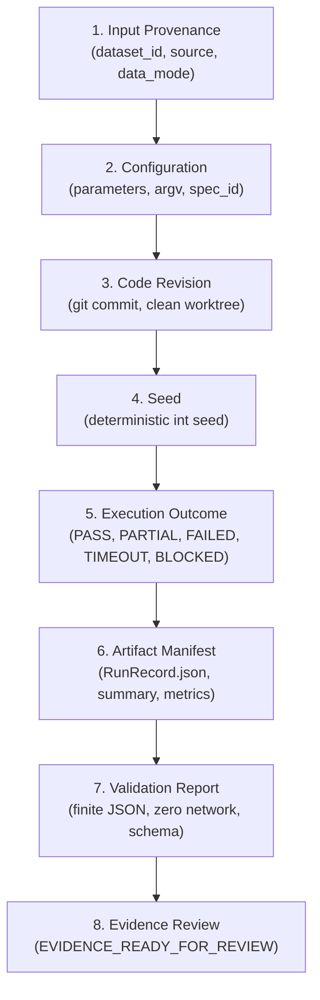

# Simulation Release Bridge

## Overview

The `tools.simulation_release_bridge` package provides an additive, fail-closed adapter connecting validated local simulation execution results to downstream research-cycle systems:
- Artifact Lineage (`tools.simulation_artifacts`, `NeuroTopologySim.SimulationArtifactLineage.v1`)
- Research-Cycle Registry & Ledger (`tools.research_cycle`)
- Evidence Graph (`NeuroTopologySim.ResearchCycleEvidenceGraph.v1`)
- Release-Evidence Evaluator (`tools.research_cycle_release`, `research_cycle_release_bundle.v1`)

The bridge operates strictly offline, verifies parent-to-child lineage continuity with SHA-256 cryptographic digests, enforces mandatory provenance without placeholders, and guarantees that operational promotion for release review is never conflated with scientific hypothesis validation.

---

## The 8-Stage Complete Verification Chain

Every simulation release bundle requires a continuous, verifiable chain across 8 distinct stages:



| Stage | Stage Key | Required Content | Fail-Closed Trigger |
| :--- | :--- | :--- | :--- |
| 1 | `input_provenance` | Valid `dataset_id`, non-placeholder `source`, explicit `data_mode` (`empirical`, `synthetic`, `proxy`). | Placeholder strings (`"unknown"`, `"null"`, `""`). |
| 2 | `configuration` | Finite parameters dict, command argv, specification ID. | Non-finite parameter values (`NaN`, `Inf`). |
| 3 | `code_revision` | Commit SHA / revision string, repository name. | Placeholder revision strings (`"unknown"`). |
| 4 | `seed` | Deterministic fixed integer seed. | Null seed, non-integer or boolean seeds. |
| 5 | `execution_outcome` | Bounded execution state (`PASS`, `PARTIAL`, `FAILED`, `TIMEOUT`, `BLOCKED`, `NOT_IMPLEMENTED`). | Unrecognized or missing state. |
| 6 | `artifact_manifest` | Indexed artifact entries with `relative_path`, `sha256`, `size_bytes`, `role`. | Missing `RunRecord.json` or summary/metrics, output escapes (`..`, `/`), temporary-only files. |
| 7 | `validation` | Validation report verifying finite JSON, offline execution, and schema compliance. | Validation failure or missing stage. |
| 8 | `evidence_review` | Operational review gate status (`EVIDENCE_READY_FOR_REVIEW`, `SYNTHETIC_ONLY`, `PROXY_ONLY`). | Missing review stage. |

---

## Artifact Promotion & Checksum Invariants

### 1. Validated PASS Promotion
Artifact promotion to release readiness (`promotion_status: "PROMOTED"`) occurs **only** when all of the following conditions are simultaneously met:
- Complete 8-stage chain is verified.
- Execution outcome is strictly `PASS`.
- Validation report indicates `passed == True`.
- No fail-closed integrity or provenance rejections exist.

When promoted, `promotion_checksum` is calculated as the deterministic SHA-256 over the canonical bundle representation.

### 2. Preservation of Non-PASS States
If execution outcome is `PARTIAL`, `FAILED`, `TIMEOUT`, `BLOCKED`, or `NOT_IMPLEMENTED`:
- The exact execution outcome state is **faithfully preserved** in `stages.execution_outcome.state`.
- `promotion_status` is marked as `NOT_PROMOTED` (or `BLOCKED`).
- **`promotion_checksum` MUST remain strictly `null` (`None`).** Non-PASS records never receive an active release checksum.

---

## Fail-Closed Security & Integrity Rejections

The adapter inspects all stages and immediately rejects:

1. **Fabricated Provenance:**
   - Any placeholder strings in `run_id`, `source`, `dataset_id`, `code_revision`:
     `"unknown"`, `"null"`, `"none"`, `"n/a"`, `"placeholder"`, `"synthetic-placeholder"`, `""`.
   - Missing or non-integer random seeds.

2. **Output-Root Escapes:**
   - Artifact paths containing parent directory traversal (`..`).
   - Artifact paths specifying root or absolute paths (`/`, `\`, or drive letters like `C:`).
   - Artifacts resolving outside the designated output directory.

3. **Temporary-Only Artifacts:**
   - Manifests consisting exclusively of scratch or temporary files (e.g. `tmp*`, `temp*`, `*.tmp`, `pytest-*`).
   - Manifests omitting canonical outputs (`RunRecord.json`, `summary.json`, `metrics.json`, `metrics.csv`).

4. **Incomplete Manifests:**
   - Omission of `RunRecord.json` or omission of both `summary.json` and `metrics.json`/`metrics.csv`.

5. **Non-Finite Metrics:**
   - Floats evaluating to `NaN`, `+Inf`, or `-Inf` anywhere in metrics, configurations, or manifests.
   - String literals representing non-finite constants (`"nan"`, `"inf"`).

6. **Missing Prerequisite Canonical Runner:**
   - If `tools.simulation_execution.runner` is unimportable or absent from current main, the adapter fails closed with `MISSING_CANONICAL_RUNNER` rather than synthesizing an ad-hoc runner.

---

## Scientific Guardrails

- **No Scientific PASS:** The adapter never emits scientific validity claims or scientific verdicts. `scientific_verdict` is permanently set to `"NOT_APPLICABLE"`.
- **No Bayes Factors:** The adapter never computes, emits, or proxies formal Bayes factors ($K$).
- **Synthetic Confinement:** Synthetic benchmark runs are permanently stamped with `evidence_class: "synthetic_demo_only"`. They cannot be promoted as empirical neuroscience evidence.
- **Proxy Confinement:** Surrogate or proxy runs are permanently stamped with `evidence_class: "proxy_only"`.
- **Null Preservation:** Missing or unobserved metrics remain strictly `null` (`None`), never zero-filled or fabricated.

---

## CLI Usage

The command-line interface is provided at `scripts/compile_simulation_release_bundle.py`.

### Basic Compilation
```bash
python scripts/compile_simulation_release_bundle.py \
    --run-dir outputs/simulations/run_001 \
    --cycle-id rc-cycle-001 \
    --output outputs/bundles/bundle_run_001.json
```

### Strict Verification with Diagnostics
```bash
python scripts/compile_simulation_release_bundle.py \
    --run-dir outputs/simulations/run_001 \
    --verify \
    --fail-closed
```

### Generate Markdown Audit Report
```bash
python scripts/compile_simulation_release_bundle.py \
    --run-dir outputs/simulations/run_001 \
    --markdown-output outputs/reports/audit_run_001.md
```
