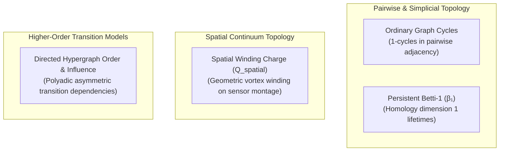

# Sparse Directed-Hypergraph Representation for Multimodal Transition Modeling

## 1. Executive Summary & Purpose

The **Sparse Directed-Hypergraph Subsystem** introduces a higher-order dependency and state-transition modeling architecture for multimodal data in `NeuroTopology-Sim`.

Traditional pairwise graphs ($G = (V, E)$ where $e = (u, v)$) are fundamentally limited to dyadic interactions. In complex neural and physiological dynamics—such as coupled electroencephalography (EEG), electrocardiography (ECG), respiration patterns, and triadic network motifs—transitions frequently occur in a **polyadic, asymmetric manner**: a subset of antecedent nodes jointly co-activates or precedes a subset of consequent target nodes.

A **directed hypergraph** generalizes dyadic directed networks by allowing hyperedges (termed directed hyperarcs) to connect an arbitrary non-empty source node set $S \subset V$ to a disjoint target node set $T \subset V$.

> [!IMPORTANT]
> **Causal Guardrail**: A directed hypergraph represents structured multivariate dependencies and temporal precedence patterns. **It does not constitute automatic proof of causal biological mechanisms.** Directional hyperedges indicate asymmetric dependency and transition structure; true causal claims require an explicit interventional or perturbational experimental design.

---

## 2. Mathematical Formalism

### 2.1 Directed Hyperedges (Hyperarcs)
A directed hyperedge $e$ is a tuple:
$$e = (S_e, T_e, w_e, \Delta t_e, c_e, \mathcal{C}_e)$$
where:
- $S_e \subset V, S_e \neq \emptyset$: the source (tail) node set.
- $T_e \subset V, T_e \neq \emptyset$: the target (head) node set, with $S_e \cap T_e = \emptyset$.
- $w_e \in \mathbb{R}^+$: the transition weight or coupling strength.
- $\Delta t_e = [t_{\text{start}}, t_{\text{end}}]$: the temporal interval or window (optional).
- $c_e \in [0, 1]$: the confidence score.
- $\mathcal{C}_e$: optional context variables (e.g., behavioral state, pharmacological condition, modality).

### 2.2 Hyperedge Order and Dimensions
- **Tail size**: $|S_e|$
- **Head size**: $|T_e|$
- **Total Hyperedge Order**:
  $$\text{order}(e) = |S_e \cup T_e| = |S_e| + |T_e|$$
- **Directed Triad**: An order-3 hyperedge where $|S_e| = 2, |T_e| = 1$ (e.g., $\{A, B\} \to \{C\}$) or $|S_e| = 1, |T_e| = 2$ (e.g., $\{A\} \to \{B, C\}$).

---

## 3. Strict Mathematical Separation from Topological Primitives

To preserve scientific rigor, this subsystem enforces strict separation between four distinct mathematical concepts:

1. **Ordinary Graph Cycles**: Cycle rank in 1-dimensional graph complexes.
2. **Persistent Homology ($\beta_1$)**: Lifetime intervals of topological 1-cycles across Vietoris-Rips or clique filtration scales.
3. **Spatial Phase Charge ($Q_{\text{spatial}}$)**: Signed integer vortex winding numbers evaluated across geometric sensor coordinates or planar projections.
4. **Directed Hyperedge Order & Influence**: Asymmetric higher-order dependencies mapping antecedent subsets to consequent subsets.

These quantities are stored in disjoint fields and never cross-labeled or conflated.

---

## 4. Sparsity Pipeline & Resource Budgeting

Enumerating all possible directed hyperedges over $N$ nodes is computationally intractable ($3^N - 2^{N+1} + 1$ possible hyperarcs). The subsystem prevents combinatorial explosion via strict resource budgeting:

### Sparsity Controls:
- **`score_threshold`**: Drops hyperedges below minimum significance or weight $\theta$.
- **`max_hyperedge_order`**: Caps total node participation (default $\le 5$) to prevent explosive simplex construction.
- **`deterministic_ordering`**: Orders hyperedges stably by $(-w_e, -c_e, \text{canonical\_key})$.
- **`top_k`**: Retains strictly the top $k$ hyperedges (default: 100).
- **`memory_budget_bytes`**: Caps maximum allocated bytes (default: 10 MB).

---

## 5. Transition Summaries & Metrics

The subsystem computes transition summaries over retained hyperedges:

1. **Order Distribution**: Histogram mapping order $k \in [2, k_{\text{max}}]$ to hyperedge frequency.
2. **Weighted Out-Influence**: Outgoing transition strength for node $v$:
   $$\text{Inf}_{\text{out}}(v) = \sum_{e: v \in S_e} w_e$$
3. **Weighted In-Influence**: Incoming transition strength for node $v$:
   $$\text{Inf}_{\text{in}}(v) = \sum_{e: v \in T_e} w_e$$
4. **Source-Target Asymmetry**: Aggregate directional imbalance across all active nodes:
   $$\mathcal{A} = \frac{\sum_{v} |\text{Inf}_{\text{out}}(v) - \text{Inf}_{\text{in}}(v)|}{\sum_v (\text{Inf}_{\text{out}}(v) + \text{Inf}_{\text{in}}(v)) + \epsilon}$$
5. **Temporal Persistence**: Mean duration of transition windows $\Delta t_e = t_{\text{end}} - t_{\text{start}}$.
6. **Context-Conditioned Transition Scores**: Average transition weight stratified by contextual markers.

---

## 6. Null Controls & Confounding Analysis

### 6.1 Common-Driver Null Control
When observing an apparent transition $S \to T$, an unmeasured or unconditioned common driver $Z \notin S \cup T$ may jointly drive both $S$ and $T$:
$$Z \to S \quad \text{and} \quad Z \to T \implies S \to T \text{ (spurious)}$$
The subsystem audits candidate common drivers and estimates confounding strength:
$$C_Z(S, T) = \frac{\text{weight}(Z \to S) \cdot \text{weight}(Z \to T)}{w_{S \to T}^2 + \epsilon}$$
If $C_Z(S, T) \ge 0.5$, the transition is flagged as `common_driver_explained = True`.

### 6.2 Label-Permutation Control
Evaluates observed transition weights against a permuted null hypothesis where target assignments are shuffled across hyperedges, reporting null means, standard deviations, $z$-scores, and empirical $p$-values.

---

## 7. Schema & Null-Safety Contract

- **Schema Version**: `1.0.0`
- **Serialization Safety**: `allow_nan=False` enforced. All missing or non-finite values serialize to explicit `null`.
- **Reproducibility**: SHA-256 checksums computed over canonically sorted interval and node strings.
- **Offline Guarantee**: Subsystem operates strictly offline with zero external network calls.
