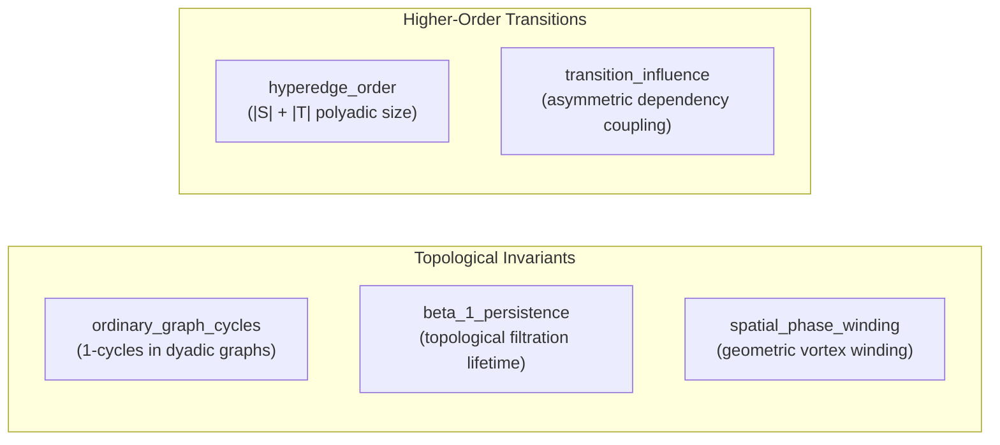

# Directed-Hypergraph Feature Contract & Forecasting Integration

## 1. Executive Summary & Purpose

The **Directed-Hypergraph Feature Adapter** integrates higher-order transition representations from `topo_monitor.higher_order` with the repository's canonical feature namespaces (`transitions.features`) and forecasting contracts (`transitions.record.TransitionRecordV1`).

Directed hyperedges (hyperarcs connecting non-empty source node sets $S$ to disjoint target node sets $T$) capture complex multivariate, polyadic dependencies in multimodal neural and physiological transitions (e.g., EEG rhythms, ECG intervals, respiration phases). To ensure these representations can be seamlessly consumed by downstream forecasting benchmarks, classification pipelines, and cross-dataset comparative workflows, this adapter:
1. **Normalizes** raw hyperedges into canonical representations with deterministic node sorting, order computation, and declared physical/computational units.
2. **Validates** structural constraints (no duplicates, bounded edge counts, finite weights, required units, and non-causal language guardrails).
3. **Extracts Comparison-Ready Canonical Features** strictly namespaced under `transition.*` in full compliance with `transitions.features.validate_feature_name`.
4. **Preserves Strict Mathematical Separation** between ordinary graph cycles, $\beta_1$ persistence, geometric spatial phase charge ($Q_{\text{spatial}}$), and higher-order hyperedge order.
5. **Evaluates 4 Null Controls**: label permutation, temporal block shift, common-driver confounding, and matched-variance surrogates.
6. **Emits Strict Null-Safe JSON** (`allow_nan=False`) with deterministic SHA-256 provenance checksums.

> [!IMPORTANT]
> **Causal Guardrail**: Hypergraph structure is a mathematical representation of dependency and transition associations—**not automatic proof of causation**. Directional hyperedges represent asymmetric temporal precedence and coupling; claiming causal biological mechanisms requires an explicit interventional or perturbational design.

---

## 2. Normalization & Canonical Formatting

Every hyperedge is normalized into a `NormalizedHyperedge` structure:
- **Canonical Node Sorting**: $S_e$ and $T_e$ are sorted lexicographically and deduplicated as immutable tuples:
  $$S_e = (s_{(1)}, s_{(2)}, \dots, s_{(p)}), \quad T_e = (t_{(1)}, t_{(2)}, \dots, t_{(q)})$$
- **Disjointness Constraint**: $S_e \cap T_e = \emptyset$.
- **Hyperedge Order**: Defined unambiguously as the total number of distinct participant nodes:
  $$\text{order}(e) = |S_e| + |T_e|$$
- **Declared Units**: Must belong to the declared allowed set:
  $$\{\text{coupling\_weight}, \text{transition\_probability}, \text{mutual\_information}, \text{arbitrary\_units}, \text{normalized\_score}\}$$
- **Canonical Key & Digest**:
  $$\text{Key}(e) = (s_1, \dots, s_p) \to (t_1, \dots, t_q)$$
  $$\text{Digest}(e) = \text{SHA256}(\text{Key}(e) \parallel \text{order} \parallel w_e \parallel c_e \parallel \Delta t_e \parallel \dots)$$

---

## 3. Validation Contract Rules

The adapter applies strict validation checks prior to feature extraction:

| Rule | Enforcement | Failure Action |
|---|---|---|
| **No Duplicate Topologies** | A given canonical key $(S) \to (T)$ may only appear once per payload. | Staged as error; duplicate edge rejected. |
| **Bounded Hyperedge Count** | Hyperedge count must not exceed `config.max_hyperedges` (default: 500). | Staged as error; prevents memory overflow. |
| **Finite Weights** | All transition weights $w_e$ must be finite and non-negative ($0 \le w_e < \infty$). | Staged as error; non-finite weights rejected. |
| **Declared Units** | Units must be explicitly declared from the allowed vocabulary. | Staged as error if missing or undeclared. |
| **Non-Causal Guardrail** | Prohibits tokens (`causes`, `causal proof`, `proves causation`, `causal mechanism`) in free text or provenance unless explicit `causal_design` metadata is provided. | Staged as error; enforces non-causal framing. |

---

## 4. Canonical Transition Features

Features extracted by the adapter are mapped to canonical identifiers validated by `transitions.features.validate_feature_name`:

| Canonical Feature Name | Mathematical Definition | Declared Unit | Description |
|---|---|---|---|
| `transition.hyperedge_count` | $|E_H|$ | dimensionless | Total count of retained sparse directed hyperedges. |
| `transition.hyperedge_order_mean` | $\frac{1}{|E_H|} \sum_{e} \text{order}(e)$ | dimensionless | Mean hyperedge order across all transition events. |
| `transition.hyperedge_order_max` | $\max_{e} \text{order}(e)$ | dimensionless | Maximum order of any retained hyperedge. |
| `transition.source_target_asymmetry` | $\frac{\sum_v |w_{\text{out}}(v) - w_{\text{in}}(v)|}{\sum_v (w_{\text{out}}(v) + w_{\text{in}}(v)) + \epsilon}$ | dimensionless | Normalized aggregate directional imbalance across nodes. |
| `transition.temporal_persistence` | $\frac{1}{|E_{\Delta t}|} \sum_{e} (t_{\text{end}} - t_{\text{start}})$ | seconds | Mean duration of transition intervals. |
| `transition.mean_transition_influence` | $\frac{1}{|V|} \sum_v (w_{\text{out}}(v) + w_{\text{in}}(v))$ | coupling_weight | Mean node-level transition influence. |
| `transition.max_transition_influence` | $\max_v (w_{\text{out}}(v) + w_{\text{in}}(v))$ | coupling_weight | Peak node-level transition influence. |
| `transition.context_conditioned_score` | $\frac{1}{|E_{\mathcal{C}}|} \sum_{e \in E_{\mathcal{C}}} w_e$ | dimensionless | Average transition score conditioned on context tags. |

---

## 5. Strict Mathematical Separation

The adapter explicitly guarantees separation between distinct topological and higher-order concepts in `HypergraphFeaturePayload.distinct_from_topology`:



- Features never encode or infer $\beta_1$ or $Q_{\text{spatial}}$.
- Hyperedge order is structurally disjoint from topological Betti numbers.

---

## 6. Four Rigorous Null Controls

To prevent spurious higher-order associations, the adapter evaluates four independent null controls:

1. **Label Permutation Null Control**: Shuffles target node assignments across hyperedges while holding source sets fixed. Evaluates observed mean weights against the permuted null distribution to compute $z$-scores and empirical $p$-values.
2. **Temporal Block Shift Control**: Circularly shifts time windows relative to the hyperedge sequence by random block offsets, assessing the preservation of temporal window coherence.
3. **Common-Driver Control**: Computes the fraction of hyperedges where a dominant third-node source co-occurs, estimating potential confounding from unconditioned drivers.
4. **Matched-Variance Control**: Generates surrogate weight vectors matched to the observed node-level mean and variance, testing whether higher-order structures exceed Gaussian variance baselines.

---

## 7. CLI Usage & Automation

Validation and payload packaging can be executed directly via the CLI:

```bash
# Standard summary report on demo fixtures
python scripts/validate_hypergraph_feature_contract.py --format summary

# Strict JSON validation mode (emits null-safe allow_nan=False JSON)
python scripts/validate_hypergraph_feature_contract.py --strict --format json --output outputs/hypergraph_features.json

# Validate custom hypergraph JSON file
python scripts/validate_hypergraph_feature_contract.py --input path/to/hyperedges.json --strict
```
